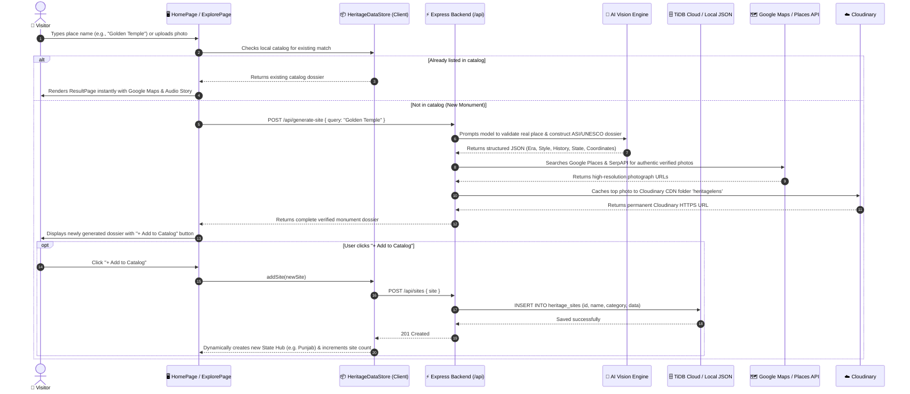

# 🏛️ HeritageLens AI — System Architecture & Modular Blueprint

This document details the high-level and granular software architecture of **HeritageLens AI**, an all-India multimodal cultural heritage discovery platform.

---

## 1. System Architecture Overview

HeritageLens AI is built as a decoupled, resilient full-stack web application with dual-mode operational capability:
1. **Cloud Production Mode**: Powered by an Express.js backend, TiDB Cloud Serverless MySQL, Cloudinary CDN, SerpAPI Google Image Search, Google Maps & Places API, and Google GenAI Vision models.
2. **Resilient Local / Offline Mode**: Uses in-memory state stores, pre-seeded JSON catalog backups (`data/heritage_sites_db.json`), OpenStreetMap/Wikipedia client-side geocoding, and browser-native SpeechSynthesis.

```mermaid
graph TD
    User([🌍 Visitor / User]) <-->|HTTPS| Cloudflare[Cloudflare CDN / DNS]
    Cloudflare <-->|Reverse Proxy| SPA[React 19 + Vite Frontend SPA]
    
    subgraph "Frontend Client Layer (Browser)"
        SPA --> Router[React Router DOM]
        Router --> Home[HomePage.tsx]
        Router --> Explore[ExplorePage.tsx]
        Router --> Result[ResultPage.tsx]
        Router --> Admin[ProfilePage.tsx - Admin Portal]
        
        Home --> SearchBar[Search & Image Upload Bar]
        Home --> StateHub[Explore Heritage by State Hub]
        Result --> MapComp[SiteLocationMap.tsx - Google Maps]
        Result --> AudioComp[AudioNarrationPlayer.tsx]
        Result --> NearbyComp[NearbyExplorerSection.tsx]
        Admin --> AdminMgr[HeritageSiteAdminManager.tsx]
        
        MapComp --> Leaflet[Leaflet.js + Google Tiles]
        MapComp --> GoogleEmbed[Google Maps 3D Embed Iframe]
        AudioComp --> WebSpeech[Web Speech Synthesis API]
    end

    subgraph "Backend API Layer (Node.js / Express)"
        SPA <-->|REST Endpoints /api/*| Express[server.js - Express Engine]
        Express --> Auth[Admin Passcode Gate /api/admin/*]
        Express --> SitesRoute[Catalog Manager /api/sites/*]
        Express --> GeocodeRoute[Live Geocoder /api/geocode]
        Express --> ImgSearch[Multi-Tier Image Engine /api/image-search]
        Express --> AI_Identify[Visual Recognition /api/identify]
        Express --> AI_Dossier[Autonomous Dossier Generator /api/generate-site]
    end

    subgraph "Persistent Storage & Cloud Services"
        SitesRoute <-->|SSL Connection Pool| TiDB[(TiDB Cloud Serverless MySQL)]
        SitesRoute -.->|Failover Sync| LocalJSON[(data/heritage_sites_db.json)]
        ImgSearch --> SerpAPI[SerpAPI - Google Images Search]
        ImgSearch --> GPlaces[Google Places New & Legacy API]
        ImgSearch --> WikiCommons[Wikimedia Commons API]
        ImgSearch --> Cloudinary[(Cloudinary Media CDN)]
        GeocodeRoute --> Nominatim[OpenStreetMap Nominatim]
        GeocodeRoute --> WikiGeo[Wikipedia Geosearch API]
        AI_Identify & AI_Dossier --> GeminiEngine[Multimodal AI Vision & LLM]
    end
```



---

## 2. Directory & Module Breakdown

```
HeritageLens/
├── data/                               # Local persistent storage & backup seeds
│   ├── heritage_sites_seed.json        # Permanent initial seed records
│   └── heritage_sites_db.json          # Live dynamic file backup when DB is offline
├── description/                        # Comprehensive technical documentation suite
│   ├── 01_system_architecture_and_modules.md
│   ├── 02_ai_pipeline_and_catalog_generation.md
│   ├── 03_google_maps_and_image_sourcing.md
│   ├── 04_database_schema_and_er_diagram.md
│   └── 05_credentials_and_deployment_manual.md
├── server/                             # Server micro-modules
│   ├── cloudinary.js                   # Cloudinary SDK wrapper & image uploader
│   ├── db.js                           # TiDB Cloud MySQL connection pool & migrations
│   ├── gemini.js                       # AI Vision & dossier generator pipelines
│   ├── places.js                       # Google Places API photograph retrieval
│   └── validator.js                    # Query sanitization & safety guardrails
├── src/                                # Frontend React Application
│   ├── components/                     # Reusable UI & Functional Components
│   │   ├── ApiKeyPromptModal.tsx       # AI configuration modal
│   │   ├── AudioNarrationPlayer.tsx    # Multi-language speech synthesizer
│   │   ├── Footer.tsx                  # Attribution, quick links & language toggle
│   │   ├── HeritageSiteAdminManager.tsx# Full CRUD catalog administration UI
│   │   ├── Navbar.tsx                  # Global navigation header with language switch
│   │   ├── NearbyExplorerSection.tsx   # Curated nearby points of interest
│   │   ├── SecurityAndTestPlanSection.tsx # System diagnostics & architecture notes
│   │   └── SiteLocationMap.tsx         # Google Maps (Roadmap, Satellite, Google 3D)
│   ├── data/                           # Client static catalog & fallback records
│   │   ├── delhiHeritage.ts            # Detailed Delhi architectural dossiers
│   │   ├── delhiNearbyData.ts          # Curated nearby food & monument data
│   │   ├── heritageSites.ts            # Master baseline monuments dataset
│   │   └── upcomingRegions.ts          # Indian States metadata & target monuments
│   ├── pages/                          # Primary Application Views
│   │   ├── ExplorePage.tsx             # State-filtered directory with search & cards
│   │   ├── HomePage.tsx                # Hero section, AI scanner & state explorer hub
│   │   ├── ProfilePage.tsx             # Restricted Admin Portal (Passcode Protected)
│   │   └── ResultPage.tsx              # Full dossier view, audio guide & interactive map
│   ├── services/                       # Client Data & Remote Synchronization Services
│   │   ├── geminiService.ts            # Client-side AI fallback & error sanitization
│   │   ├── heritageDataStore.ts        # Live reactive catalog store with TiDB sync
│   │   └── storage.ts                  # LocalStorage wrapper (settings, tokens, history)
│   ├── types/                          # TypeScript Interfaces & Data Contracts
│   │   └── index.ts                    # Core definitions: HeritageSite, Result, UserSettings
│   ├── utils/                          # Geolocation, Coordinates & Fallbacks
│   │   ├── geoCoordinates.ts           # All-India GPS registry & live geocoding resolver
│   │   └── imageFallback.ts            # Robust multi-domain image fallback loader
│   ├── App.tsx                         # Root router & layout wrapper
│   ├── index.css                       # Global styles, Tailwind CSS & custom animations
│   └── main.tsx                        # Application mount point
├── .env                                # Local environment secrets (Server & DB)
├── .env.example                        # Template environment configuration
├── package.json                        # Node dependencies & build scripts
├── server.js                           # Express REST API server & static file host
├── tsconfig.json                       # TypeScript compiler configuration
└── vite.config.ts                      # Vite bundler build settings & dev proxy
```

---

## 3. Component Interaction & Data Flow



---

## 4. Frontend State Management & Lifecycle

- **`HeritageDataStore`**:
  - Serves as the single source of truth in the browser.
  - Automatically fetches the full catalog on initial mount via `GET /api/sites`.
  - Maintains an in-memory cache and local storage fallback.
  - Subscribes to window focus events (`window.addEventListener('focus')`) to ensure catalog updates in another admin tab sync automatically without page reloads.
- **Dynamic State Hub Generation**:
  - In [src/pages/HomePage.tsx](file:///c:/Users/ratan/OneDrive/Desktop/FOLDERS/HeritageLens/src/pages/HomePage.tsx), Section 5 ("Explore Heritage by State") groups all active monuments by `site.state`.
  - When an admin or user adds a monument belonging to a previously unrepresented state (e.g., Tamil Nadu, Punjab, Rajasthan), the system dynamically provisions a state hub card showing live monument counts and direct filtering links.
