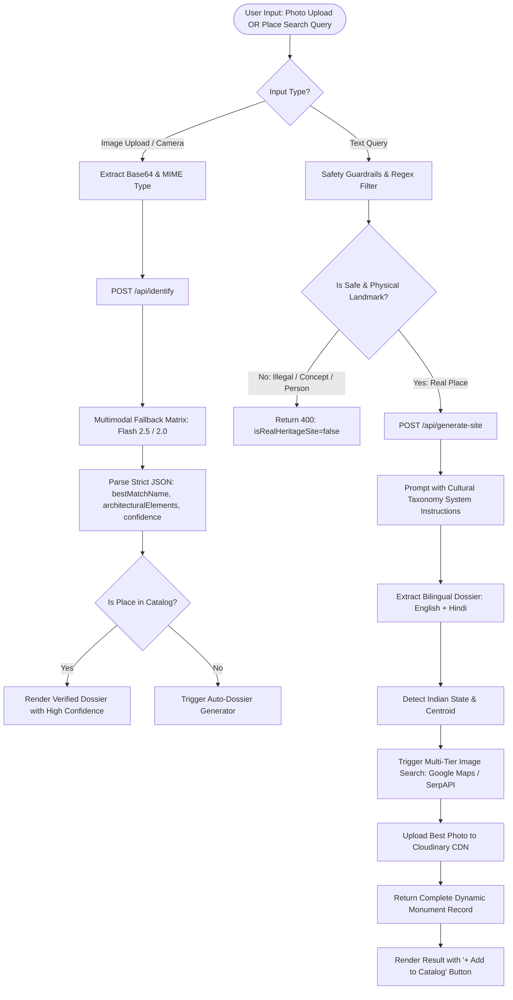

# 🧠 AI Pipeline, Safety Guardrails & Dynamic Catalog Generation

This document explains the end-to-end artificial intelligence architecture of **HeritageLens AI**, from front-facing multimodal scanning and query validation to autonomous state catalog generation and admin management.

---

## 1. High-Level AI Architecture & Lifecycle



---

## 2. Safety Guardrails & Query Sanitization

Before invoking expensive AI tokens or external APIs, user queries pass through multi-layer validation implemented in [server/validator.js](file:///c:/Users/ratan/OneDrive/Desktop/FOLDERS/HeritageLens/server/validator.js):

1. **Length & Structure Validation**:
   - Rejects empty strings, strings exceeding 150 characters, or pure punctuation strings.
2. **Explicit / Harmful Content Shield**:
   - Blocks illegal contraband, weapons, adult material, hate speech, or dangerous goods.
3. **Non-Place Entity Filter**:
   - Blocks queries referring to gadgets, animals, personal names, food items, software applications, or abstract concepts (e.g., "laptop", "dog", "python coding", "bitcoin").
4. **AI-Level Physical Landmark Assertion**:
   - The AI system instruction enforces strict rejection:
   ```typescript
   STRICT REJECTION RULES:
   You MUST return "isRealHeritageSite": false if the query:
   1. Is illegal, dangerous, weapons, violence, drugs, contraband, adult, or inappropriate.
   2. Is NOT a physical place or monument (e.g., an object, gadget, animal, person, software, company, food, abstract concept).
   3. Is completely fictional or mythological with no physical geographical site on Earth.
   ```

---

## 3. Autonomous Bilingual Dossier Generation

When a user searches for an uncataloged monument (for example, *"Golden Temple"*, *"Meenakshi Temple"*, or *"Brihadeeswarar Temple"*), the backend executes an autonomous research pipeline:

### A. Structured Data Synthesis
The AI model returns a comprehensive, typed JSON payload matching the `HeritageSite` schema:
- **`name` & `hindiName`**: Official English and Devanagari Hindi monument names.
- **`state` & `hindiState`**: The Indian state or union territory (e.g., "Punjab" / "पंजाब", "Tamil Nadu" / "तमिलनाडु").
- **`city` & `hindiCity`**: Geographic city or municipal region.
- **`shortDescription` & `hindiShortDescription`**: 1-2 sentence overview for rapid orientation.
- **`fullHistory` & `hindiFullHistory`**: Rigorous architectural history, dynasties, construction eras, and patronage.
- **`builtYear` & `builtBy`**: Exact historical dates and architects/rulers.
- **`architecturalStyle`**: Specific architectural classification (e.g., Dravidian, Indo-Islamic, Mughal, Rajput, Sikh).
- **`culturalSignificance` & `hindiCulturalSignificance`**: Societal, spiritual, and historical heritage relevance.
- **`interestingFacts` & `hindiInterestingFacts`**: Curated facts for visitors.
- **`folkloreOrLegends`**: Oral traditions, legends, and historical folklore.
- **`travelTips`**: Timings, metro access, best visiting hours, and visitor guidelines.
- **`nearbyAttractions`**: Distance-indexed nearby points of interest.
- **`latitude` & `longitude`**: Exact geographic GPS coordinates.

---

## 4. Multi-Model Resilient Fallback Matrix

To guarantee high availability and eliminate rate-limit disruptions, both [server/gemini.js](file:///c:/Users/ratan/OneDrive/Desktop/FOLDERS/HeritageLens/server/gemini.js) and [src/services/geminiService.ts](file:///c:/Users/ratan/OneDrive/Desktop/FOLDERS/HeritageLens/src/services/geminiService.ts) implement an automated model rotation matrix:

```javascript
const FALLBACK_MODELS = [
  'gemini-3.8-flash',
  'gemini-3.5-flash-lite',
  'gemini-4-argon',
  'gemini-3.1-flash-lite',
  'gemini-2.5-flash',
  'gemini-2.0-flash'
];
```

If a model returns HTTP 429 (`RESOURCE_EXHAUSTED`) or is temporarily overloaded, the engine automatically tries the next model in sequence within milliseconds without dropping user requests.

---

## 5. Admin Control Portal & Catalog Lifecycle

The **Admin Control Portal** ([src/pages/ProfilePage.tsx](file:///c:/Users/ratan/OneDrive/Desktop/FOLDERS/HeritageLens/src/pages/ProfilePage.tsx) and [src/components/HeritageSiteAdminManager.tsx](file:///c:/Users/ratan/OneDrive/Desktop/FOLDERS/HeritageLens/src/components/HeritageSiteAdminManager.tsx)) provides full governance over the monument catalog:

1. **Security Gate**:
   - Access requires a private administrator secret key (`ADMIN_SECRET_KEY`).
   - Sessions issue a secure, time-stamped authorization token verified via `/api/admin/verify` and `/api/admin/check-session`.
2. **Catalog Management Actions**:
   - **Add Monument**: Fill in manual details or use AI auto-complete to draft an entire verified dossier in seconds.
   - **Edit Monument**: Modify timings, entry fees, metro stations, descriptions, and photographic URLs.
   - **Delete Record**: Remove outdated or duplicate monument records from TiDB Cloud and local backups simultaneously.
   - **Image Re-Fetcher**: Trigger live Google Places / Google Images re-fetching to update monument cover photographs.
   - **System Diagnostics**: Real-time health metrics showing database connection status, Cloudinary CDN reachability, and AI vision engine availability.
