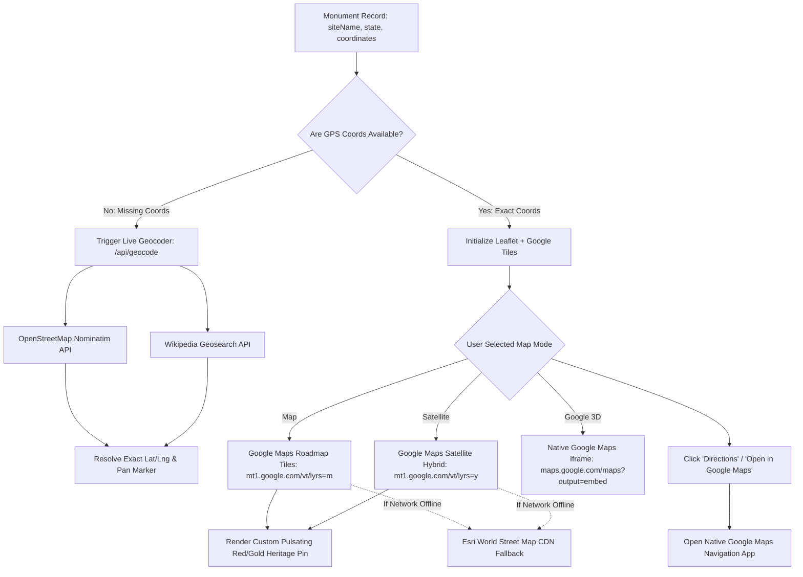
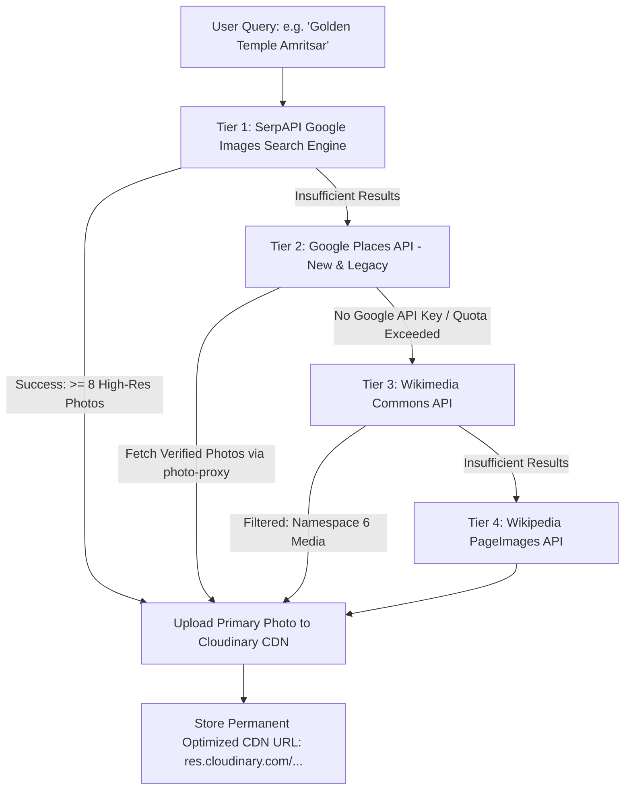

# 🗺️ Google Maps Geolocation & Multi-Tier Image Sourcing Pipeline

This document details the geolocation engine, interactive mapping layers, and the 4-tier authentic photograph retrieval pipeline that powers **HeritageLens AI**.

---

## 1. Google Maps Integration Architecture

HeritageLens AI provides an interactive, zero-quota mapping experience inside [src/components/SiteLocationMap.tsx](file:///c:/Users/ratan/OneDrive/Desktop/FOLDERS/HeritageLens/src/components/SiteLocationMap.tsx).



### The Three Interactive Map Modes
1. **"Map" (Google Roadmap Tiles)**:
   - URL Template: `https://mt1.google.com/vt/lyrs=m&x={x}&y={y}&z={z}`
   - High-definition road networks, transit stations, metro lines, and local landmarks.
   - Overlaid with a custom pulsating CSS pin marker and verified metadata popup.
2. **"Satellite" (Google Aerial & Hybrid View)**:
   - URL Template: `https://mt1.google.com/vt/lyrs=y&x={x}&y={y}&z={z}`
   - High-resolution satellite photography with street and monument boundary overlays.
3. **"Google 3D" (Native Google Maps Embed)**:
   - URL Template: `https://maps.google.com/maps?q=${encodeURIComponent(query)}&z=16&output=embed`
   - Real-time Google Maps viewport featuring Google's 3D terrain, official business listings, reviews, and interactive pan/zoom.

---

## 2. Live Dynamic Geocoding Service (`/api/geocode`)

If a newly discovered monument has approximate or missing coordinates, the system executes real-time geocoding:

1. **Endpoint**: `GET /api/geocode?q={monumentName + state + India}`
2. **First Tier (OpenStreetMap Nominatim)**:
   - Queries `https://nominatim.openstreetmap.org/search` with a compliant application User-Agent header.
   - Extracts millimeter-accurate latitude and longitude.
3. **Second Tier (Wikipedia Geosearch)**:
   - Queries `https://en.wikipedia.org/w/api.php?action=query&prop=coordinates` using CORS-enabled endpoints.
   - Returns verified geographical coordinates associated with the official Wikipedia dossier.

---

## 3. Multi-Tier Authentic Photograph Sourcing Pipeline

When a user searches for a monument, finding real, authentic photographs (rather than generic illustrations or stock models) is critical. The backend ([server.js](file:///c:/Users/ratan/OneDrive/Desktop/FOLDERS/HeritageLens/server.js) and [server/places.js](file:///c:/Users/ratan/OneDrive/Desktop/FOLDERS/HeritageLens/server/places.js)) runs a 4-tier cascading search:



### Detailed Tier Breakdown

#### Tier 1: SerpAPI Google Images Search Engine
- Uses `SERPAPI_KEY` to query Google Images directly:
  `https://serpapi.com/search.json?engine=google_images&q={cleanQuery}&google_domain=google.co.in&gl=in&hl=en`
- Retrieves original, high-resolution photographs directly from news, tourism boards, and verified travel archives.

#### Tier 2: Google Places API (New & Legacy)
- Query endpoint: `https://places.googleapis.com/v1/places:searchText`
- FieldMask: `places.id,places.displayName,places.formattedAddress,places.photos`
- Authenticates with `GOOGLE_PLACES_API_KEY` or `GOOGLE_MAPS_API_KEY`.
- Proxies images securely through `/api/places/photo-proxy?name={photoName}` to protect API credentials from browser exposure.

#### Tier 3: Wikimedia Commons Search API
- Query endpoint: `https://commons.wikimedia.org/w/api.php?action=query&generator=search`
- Filters for public domain, CC-BY-SA, and archaeological survey photographs.
- Applies relevance scoring to eliminate unrelated file uploads.

#### Tier 4: Wikipedia PageImages API
- Query endpoint: `https://en.wikipedia.org/w/api.php?action=query&prop=pageimages&pithumbsize=1200`
- Fetches the canonical hero image associated with the monument's English Wikipedia page.

---

## 4. Cloudinary Media CDN Storage

To guarantee zero broken image links and lightning-fast loading speeds across mobile devices:
1. When a new site is generated, the backend invokes [server/cloudinary.js](file:///c:/Users/ratan/OneDrive/Desktop/FOLDERS/HeritageLens/server/cloudinary.js):
   ```javascript
   await cloudinary.uploader.upload(imageUrl, {
     folder: 'heritagelens',
     transformation: [{ quality: 'auto:eco', fetch_format: 'auto' }]
   });
   ```
2. The image is compressed into modern WebP/AVIF formats and delivered globally over Cloudinary’s Content Delivery Network.
3. If an image fails to load on a client browser, [src/utils/imageFallback.ts](file:///c:/Users/ratan/OneDrive/Desktop/FOLDERS/HeritageLens/src/utils/imageFallback.ts) intercepts the `onError` event and seamlessly swaps in a verified high-resolution category photograph.
