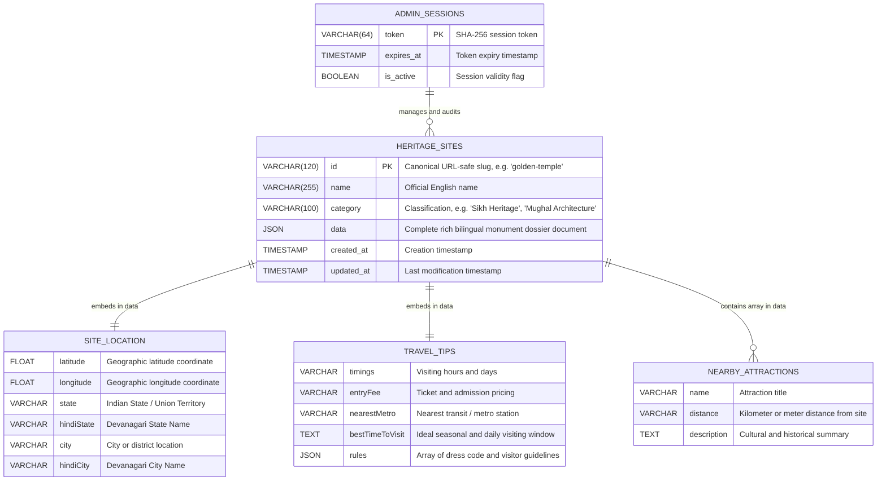

# 🗄️ Database Architecture, Schema & Entity-Relationship (ER) Blueprint

This document details the database architecture, table definitions, JSON document storage patterns, and Entity-Relationship model powering **HeritageLens AI**.

---

## 1. Storage Architecture Overview

HeritageLens AI utilizes a hybrid storage architecture:
1. **Primary Cloud Layer (TiDB Cloud Serverless MySQL)**:
   - Globally distributed, ACID-compliant relational MySQL database.
   - Secure TLS/SSL connection with auto-scaling storage and zero-maintenance serverless pooling.
2. **Failover Resilience Layer (Local JSON Sync)**:
   - In case of cloud network partitions or local offline testing, operations immediately fail over to [data/heritage_sites_db.json](file:///c:/Users/ratan/OneDrive/Desktop/FOLDERS/HeritageLens/data/heritage_sites_db.json).
   - Once the TiDB connection is restored, records synchronize seamlessly.

---

## 2. Entity-Relationship (ER) Diagram



---

## 3. SQL Table Definition

The primary table is initialized automatically upon backend boot via [server/db.js](file:///c:/Users/ratan/OneDrive/Desktop/FOLDERS/HeritageLens/server/db.js):

```sql
CREATE TABLE IF NOT EXISTS heritage_sites (
  id VARCHAR(120) NOT NULL PRIMARY KEY,
  name VARCHAR(255) NOT NULL,
  category VARCHAR(100),
  data JSON NOT NULL,
  created_at TIMESTAMP DEFAULT CURRENT_TIMESTAMP,
  updated_at TIMESTAMP DEFAULT CURRENT_TIMESTAMP ON UPDATE CURRENT_TIMESTAMP,
  INDEX idx_category (category),
  INDEX idx_name (name)
) ENGINE=InnoDB DEFAULT CHARSET=utf8mb4 COLLATE=utf8mb4_unicode_ci;
```

---

## 4. Rich JSON Document Schema (`data` column)

Each monument record stored in the `data` column conforms to the TypeScript `HeritageSite` contract:

```typescript
{
  id: string;                      // "sis-ganj-sahib"
  name: string;                    // "Gurudwara Sis Ganj Sahib"
  hindiName: string;               // "गुरुद्वारा सीस गंज साहिब"
  shortDescription: string;        // High-level overview
  hindiShortDescription: string;
  fullHistory: string;             // Detailed historical chronicle
  hindiFullHistory: string;
  builtYear: string;               // "1783 CE"
  builtBy: string;                 // "Sardar Baghel Singh"
  architecturalStyle: string;      // "Traditional Sikh Architecture"
  culturalSignificance: string;   // Societal and spiritual significance
  hindiCulturalSignificance: string;
  interestingFacts: string[];      // Array of bullet points
  hindiInterestingFacts: string[];
  folkloreOrLegends: string[];     // Oral histories and legends
  hindiFolkloreOrLegends: string[];
  travelTips: {
    timings: string;
    entryFee: string;
    nearestMetro: string;
    bestTimeToVisit: string;
    rules: string[];
  };
  nearbyAttractions: Array<{
    name: string;
    distance: string;
    description: string;
  }>;
  imageUrl: string;                // Primary Cloudinary HTTPS URL
  imageAlt: string;                // Accessible description
  sourceNote: string;              // ASI / UNESCO / DSGMC attribution
  tags: string[];                  // ["Sikh Heritage", "Martyrdom", "Old Delhi"]
  
  // Geolocation & State Registry Metadata
  state: string;                   // "Delhi"
  hindiState: string;              // "दिल्ली"
  city: string;                    // "Old Delhi"
  hindiCity: string;               // "पुरानी दिल्ली"
  latitude: number;                // 28.655988
  longitude: number;               // 77.232561
  coordinates: {
    lat: number;
    lng: number;
  };
}
```

---

## 5. Seed Synchronization & Backup Flow

1. **Boot Initialization**:
   - The backend checks if the `heritage_sites` table contains any records.
   - If the table is empty (e.g. freshly created database), it automatically parses [data/heritage_sites_seed.json](file:///c:/Users/ratan/OneDrive/Desktop/FOLDERS/HeritageLens/data/heritage_sites_seed.json) and inserts all baseline monuments in a single transaction.
2. **Local Dynamic Mirror**:
   - Every write operation (`POST /api/sites`, `PUT /api/sites/:id`, `DELETE /api/sites/:id`) writes to TiDB Cloud and immediately updates [data/heritage_sites_db.json](file:///c:/Users/ratan/OneDrive/Desktop/FOLDERS/HeritageLens/data/heritage_sites_db.json).
   - This ensures full offline capability for demos, continuous integration runs, and isolated development environments.
